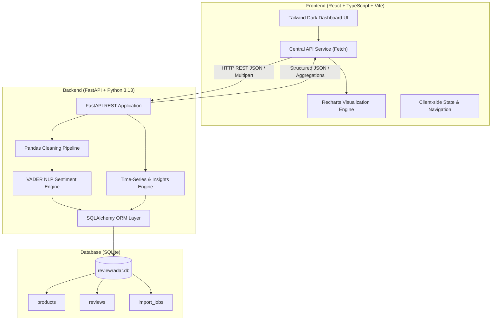
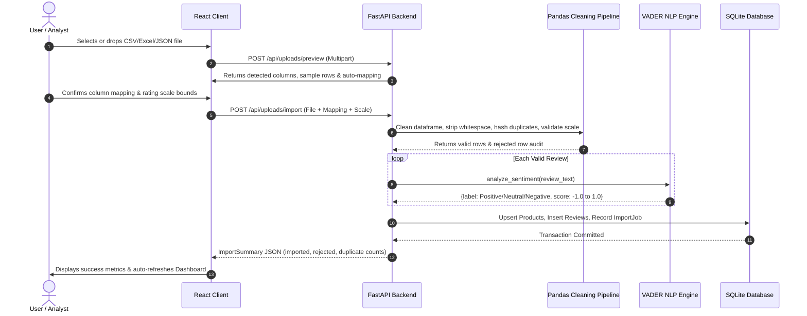

# ReviewRadar — Full-Stack Product Review Analytics Platform

[](https://www.python.org/)
[](https://fastapi.tiangolo.com/)
[](https://react.dev/)
[](https://www.typescriptlang.org/)
[](https://vitejs.dev/)
[](https://tailwindcss.com/)
[](https://pytest.org/)
[](LICENSE)

> A modern, full-stack data analytics and intelligence dashboard engineered to ingest, clean, explore, and analyze consumer product reviews using natural language processing (NLP), time-series modeling, and relational data architecture.

---

## Table of Contents
1. [Project Overview](#1-project-overview)
2. [Problem Statement](#2-problem-statement)
3. [Core Objectives](#3-core-objectives)
4. [Key Features](#4-key-features)
5. [System Architecture](#5-system-architecture)
6. [Technology Stack](#6-technology-stack)
7. [Repository Structure](#7-repository-structure)
8. [Data Flow Pipeline](#8-data-flow-pipeline)
9. [Database Schema Design](#9-database-schema-design)
10. [RESTful API Endpoints](#10-restful-api-endpoints)
11. [Data Cleaning & Hygiene Methodology](#11-data-cleaning--hygiene-methodology)
12. [Sentiment Analysis Methodology & Limitations](#12-sentiment-analysis-methodology--limitations)
13. [Visualizations & Analytics](#13-visualizations--analytics)
14. [Time-Series Trends & Forecasting](#14-time-series-trends--forecasting)
15. [Installation & Setup Instructions](#15-installation--setup-instructions)
16. [Running the Application Locally](#16-running-the-application-locally)
17. [Synthetic Sample Dataset](#17-synthetic-sample-dataset)
18. [Automated Testing & Build Verification](#18-automated-testing--build-verification)
19. [Screenshots & UI Walkthrough](#19-screenshots--ui-walkthrough)
20. [Security & Production Readiness](#20-security--production-readiness)
21. [Future Scope](#21-future-scope)

---

## 1. Project Overview

**ReviewRadar** is an end-to-end full-stack analytics platform designed to solve the challenge of transforming noisy, unstructured customer feedback into actionable business intelligence. Built for college data analytics research, product management, and quality engineering, ReviewRadar combines a **FastAPI (Python 3)** backend with a high-performance **React (TypeScript + Vite)** frontend styled in a dark SaaS aesthetic.

The platform provides file ingestion (CSV, Excel `.xlsx`, JSON), automated schema mapping, an auditing data-cleaning pipeline, VADER natural language sentiment analysis, box-plot statistical dispersion charts, chronological moving averages, automated insight generation, and review exploration.

---

## 2. Problem Statement

E-commerce marketplaces and review aggregators receive massive volumes of customer feedback daily. However:
- **Data Dirtiness:** Raw review feeds frequently contain duplicate records, blank text fields, missing ratings, whitespace noise, unstandardized column headers, and out-of-scale star ratings (e.g., rating `9.0` on a standard `1-5` scale).
- **Arbitrary Imputation Pitfall:** Many basic analytics systems silently discard bad records or fill missing ratings with arbitrary averages, distorting underlying distributions.
- **Surface-Level Metrics:** Relying strictly on simple arithmetic means hides rating variance, bimodal distributions, and customer friction clusters.
- **Unstructured Text:** Star ratings tell *what* customers felt, but unstructured review commentary contains the critical *why*. Extracting this requires automated NLP polarity scoring and keyword frequency mining.

---

## 3. Core Objectives

1. **Robust Ingestion & Schema Flexibility:** Ingest CSV, Excel, and JSON files while allowing users to interactively map disparate column headers to standard schema fields.
2. **Transparent Data Cleansing:** Implement a Pandas pipeline that normalizes text, strips whitespace, detects duplicates via cryptographic content hashes (`SHA-256`), validates boundaries without arbitrary imputation, and computes a comprehensive **Data Quality Score (0–100%)**.
3. **Sentiment Polarity Scoring:** Classify commentary using rule-based VADER sentiment analysis into Positive, Neutral, and Negative categories while explicitly acknowledging domain limitations (sarcasm, mixed pros/cons).
4. **Statistical Depth:** Calculate dispersion metrics (Mean, Median, Mode, Standard Deviation, IQR, Q1/Q3 percentiles) and visualize product rating ranges via box-and-whisker representations.
5. **Temporal Trend Modeling:** Track review volume and rating trajectories over time with 7-period Simple Moving Averages (SMA) and Exponential Moving Averages (EMA), accompanied by cautious trend projections when sufficient observations exist.
6. **Actionable Insights:** Dynamically surface category leaders, underperformers, and frequent customer pain point tokens.

---

## 4. Key Features

- **Executive KPI Dashboard:** Real-time metrics for total reviews, average rating, sentiment shares, active product counts, and overall data hygiene score.
- **Drag-and-Drop Review Upload:** Automatic file extension and size validation (up to 10 MB), header auto-detection, interactive column mapping dropdowns, and rating scale boundaries (`[1.0 - 5.0]`).
- **Interactive Review Explorer:** Server-side search and filtering by product, exact rating, sentiment classification, date ranges, and multiple sort orders with pagination.
- **Deep Analytics Suite:**
  - Discrete rating histogram (1 to 5 stars).
  - Custom Box-and-Whisker rating dispersion plot comparing product quartiles.
  - Horizontal bar charts ranking products by average rating.
  - Sentiment polarity donut chart and stacked sentiment proportion by star rating.
  - Time-series area charts with 7-period SMA and toggleable linear trend forecasts.
- **Data Hygiene Audit Page:** Before-versus-after cleaning statistics, audit explanations for all validation rules, and sample inspections of rejected records.
- **Automated Business Insights:** Algorithmic detection of top/bottom products with sample thresholds, mode rating clusters, and frequency extraction of negative feedback keywords.
- **Settings & Database Controls:** In-memory or on-disk SQLite controls with 1-click synthetic dataset loading and complete database reset tools.

---

## 5. System Architecture



---

## 6. Technology Stack

### Frontend
- **Framework:** React 18 with TypeScript
- **Build Tool:** Vite 5 (instant HMR, optimized production rollup bundles)
- **Styling:** Tailwind CSS 3.4 (custom charcoal/navy `#090D16` palette with cyan, violet, and blue accents)
- **Visualizations:** Recharts 2.12 (responsive SVG bar, area, line, and pie charts)
- **Icons:** Lucide React
- **HTTP Communication:** Native Fetch API with strongly typed schemas

### Backend
- **Framework:** FastAPI 0.110+ (asynchronous ASGI framework, OpenAPI 3.0 documentation)
- **Data Analysis:** Pandas 2.2+ & NumPy 1.26+ (vectorized dataframe operations)
- **Sentiment Analysis:** `vaderSentiment` 3.3+ (Valence Aware Dictionary and sEntiment Reasoner)
- **Validation:** Pydantic v2 (strict type validation and settings management)
- **Database ORM:** SQLAlchemy 2.0+ (relational mappings, cascades, and indexed queries)
- **Database:** SQLite 3 (lightweight, zero-configuration relational storage)
- **Testing:** Pytest 8.0+ with `fastapi.testclient.TestClient` and temporary in-memory StaticPool fixtures

---

## 7. Repository Structure

```
ReviewRadar/
├── backend/
│   ├── app/
│   │   ├── main.py                     # FastAPI entry point, CORS & lifespan hooks
│   │   ├── api/
│   │   │   ├── dependencies.py         # Database session dependency injection
│   │   │   └── routes/
│   │   │       ├── health.py           # GET /api/health
│   │   │       ├── uploads.py          # POST /api/uploads/preview & /import
│   │   │       ├── reviews.py          # GET /api/reviews (filtering & pagination)
│   │   │       ├── products.py         # GET /api/products
│   │   │       ├── analytics.py        # Summary, ratings, sentiment, trends, quality
│   │   │       ├── insights.py         # GET /api/insights
│   │   │       └── sample_data.py      # Load sample, download CSV, reset DB
│   │   ├── core/
│   │   │   └── config.py               # Pydantic Settings & environment variables
│   │   ├── db/
│   │   │   ├── base.py                 # SQLAlchemy metadata aggregation
│   │   │   └── session.py              # Engine creation and SessionLocal factory
│   │   ├── models/
│   │   │   ├── product.py              # Product entity
│   │   │   ├── review.py               # Review entity with content hash index
│   │   │   └── import_job.py           # ImportJob auditing entity
│   │   ├── schemas/
│   │   │   ├── analytics.py            # Analytics response models
│   │   │   ├── product.py              # Product serialization models
│   │   │   ├── review.py               # Review & pagination models
│   │   │   └── upload.py               # Preview & ImportSummary models
│   │   ├── services/
│   │   │   ├── analytics_service.py    # Multi-variable statistical aggregations
│   │   │   ├── import_service.py       # File parsing, cleaning execution, DB save
│   │   │   └── review_service.py       # Review querying, sorting, pagination
│   │   └── analytics/
│   │       ├── cleaner.py              # Pandas cleaning pipeline & duplicate hasher
│   │       ├── insights.py             # Keyword tokenization & insight rules
│   │       ├── quality.py              # Data Quality Index scoring formula
│   │       ├── sentiment.py            # VADER sentiment analysis engine
│   │       └── trends.py               # SMA, EMA, and linear trend projection
│   ├── tests/
│   │   ├── conftest.py                 # SQLite StaticPool in-memory fixture
│   │   ├── test_health.py
│   │   ├── test_cleaning.py
│   │   ├── test_sentiment.py
│   │   ├── test_imports.py
│   │   ├── test_reviews.py
│   │   ├── test_analytics.py
│   │   ├── test_insights.py
│   │   └── test_sample_data.py
│   ├── pytest.ini                      # Pytest discovery configuration
│   ├── requirements.txt                # Python dependencies
│   └── .env.example                    # Backend environment template
├── frontend/
│   ├── src/
│   │   ├── components/
│   │   │   └── common/
│   │   │       ├── Badge.tsx           # Sentiment & status pill badges
│   │   │       ├── EmptyState.tsx      # Onboarding empty state callouts
│   │   │       ├── LoadingSpinner.tsx  # Animated loading spinners
│   │   │       ├── MetricCard.tsx      # Executive KPI card component
│   │   │       └── StarRating.tsx      # Fractional SVG star rating visualizer
│   │   ├── layouts/
│   │   │   ├── AppLayout.tsx           # Responsive shell layout
│   │   │   ├── Navbar.tsx              # Header with dataset badge & quick actions
│   │   │   └── Sidebar.tsx             # Collapsible 7-item navigation bar
│   │   ├── pages/
│   │   │   ├── DashboardPage.tsx       # Executive KPI dashboard
│   │   │   ├── UploadPage.tsx          # Upload, preview, map & import
│   │   │   ├── ExplorerPage.tsx        # Filterable review data grid
│   │   │   ├── AnalyticsPage.tsx       # Deep distributions, box plots, trends
│   │   │   ├── DataQualityPage.tsx     # Hygiene audit & before/after metrics
│   │   │   ├── InsightsPage.tsx        # Machine-generated business takeaways
│   │   │   └── SettingsPage.tsx        # System controls & methodology notes
│   │   ├── services/
│   │   │   └── api.ts                  # Central API client
│   │   ├── types/
│   │   │   └── index.ts                # TypeScript domain models
│   │   ├── utils/
│   │   │   └── formatters.ts           # Date, number, and color formatters
│   │   ├── App.tsx                     # Top-level state and routing
│   │   ├── main.tsx                    # React DOM mounting
│   │   ├── vite-env.d.ts               # Vite client types
│   │   └── index.css                   # Tailwind imports & scrollbar styles
│   ├── index.html
│   ├── package.json
│   ├── postcss.config.js
│   ├── tailwind.config.js
│   ├── tsconfig.json
│   ├── vite.config.ts
│   └── .env.example
├── data/
│   └── sample_reviews.csv              # Synthetic test dataset with intentional flaws
├── docs/                               # Additional documentation assets
├── .gitignore
└── README.md
```

---

## 8. Data Flow Pipeline



---

## 9. Database Schema Design

The SQLite database is structured into three normalized relational tables:

### 1. `products`
| Column | Type | Constraints | Description |
|---|---|---|---|
| `id` | Integer | Primary Key, Auto-increment | Internal unique product ID |
| `name` | String(255) | Unique, Not Null, Indexed | Normalized product name |
| `external_id` | String(100) | Nullable, Indexed | External SKU / ASIN |
| `created_at` | DateTime | Not Null | Creation timestamp (UTC) |

### 2. `reviews`
| Column | Type | Constraints | Description |
|---|---|---|---|
| `id` | Integer | Primary Key, Auto-increment | Internal unique review ID |
| `external_id` | String(100) | Nullable, Indexed | Original review identifier |
| `product_id` | Integer | Foreign Key (`products.id`), Cascade Delete | Associated product reference |
| `rating` | Float | Not Null, Indexed | Validated rating within `[min, max]` |
| `review_title` | String(500) | Nullable | Optional review summary |
| `review_text` | Text | Not Null | Review body text |
| `review_date` | Date | Nullable, Indexed | Chronological submission date |
| `sentiment_label`| String(20) | Not Null, Indexed | `Positive`, `Neutral`, or `Negative` |
| `sentiment_score`| Float | Not Null | VADER compound score (`-1.0` to `+1.0`) |
| `reviewer_name` | String(255) | Nullable | Optional customer display name |
| `verified_purchase` | Boolean | Nullable | Verified buyer indicator |
| `content_hash` | String(64) | Indexed | SHA-256 fingerprint for duplicate detection |
| `created_at` | DateTime | Not Null | Record insertion timestamp (UTC) |

*Composite Indexes:* `ix_reviews_product_rating` (`product_id`, `rating`), `ix_reviews_sentiment_date` (`sentiment_label`, `review_date`).

### 3. `import_jobs`
| Column | Type | Constraints | Description |
|---|---|---|---|
| `id` | Integer | Primary Key, Auto-increment | Ingestion task ID |
| `filename` | String(255) | Not Null | Source file name |
| `uploaded_at` | DateTime | Not Null | Ingestion timestamp (UTC) |
| `rows_processed` | Integer | Not Null | Total rows in file |
| `rows_imported` | Integer | Not Null | Valid rows committed to DB |
| `rows_rejected` | Integer | Not Null | Rows discarded due to flaws |
| `rows_duplicate` | Integer | Not Null | Duplicates identified |
| `status` | String(50) | Not Null | `completed`, `partial`, or `failed` |
| `summary_details`| Text | Nullable | JSON-encoded audit of rejection reasons & sample rows |

---

## 10. RESTful API Endpoints

Interactive Swagger documentation is automatically generated by FastAPI at:
`http://localhost:8000/docs`

| Method | Endpoint | Description |
|---|---|---|
| `GET` | `/api/health` | Health check verifying API availability, version, and project name. |
| `POST` | `/api/uploads/preview` | Uploads file bytes to inspect schema, detect columns, and sample first 5 rows. |
| `POST` | `/api/uploads/import` | Executes cleaning pipeline, VADER NLP, and commits reviews to database. |
| `GET` | `/api/dashboard/summary` | Aggregates high-level metrics, distributions, top/lowest products, and recent reviews. |
| `GET` | `/api/reviews` | Server-paginated review list with search, product, rating, sentiment, and date filters. |
| `GET` | `/api/products` | Lists catalog products with computed review counts and average ratings. |
| `GET` | `/api/analytics/ratings` | Detailed rating frequency and per-product statistical box-plot moments. |
| `GET` | `/api/analytics/sentiment` | Overall sentiment counts, sentiment-by-rating crosstabs, and sentiment-by-product breakdown. |
| `GET` | `/api/analytics/trends` | Time-series aggregations, 7-period SMA/EMA, and optional linear volume forecast. |
| `GET` | `/api/analytics/data-quality` | Data Quality Index audit, before/after comparisons, and problematic row excerpts. |
| `GET` | `/api/insights` | Algorithmic business insights and non-stopword keyword frequency analysis. |
| `POST` | `/api/sample-data/load` | Ingests the bundled synthetic 35-review sample dataset with intentional flaws. |
| `GET` | `/api/sample-data/download` | Downloads standard CSV template with valid structure. |
| `POST` | `/api/database/reset` | Clears all products, reviews, and import logs to restore a pristine state. |

---

## 11. Data Cleaning & Hygiene Methodology

Data quality is treated as a first-class feature rather than an afterthought. The cleaning pipeline implements the following deterministic rules:

1. **Header Normalization & Auto-Mapping:** File column names are trimmed, converted to lowercase, and mapped against standard field alias patterns (e.g., `stars` $\rightarrow$ `rating`, `comments` $\rightarrow$ `review_text`, `asin` $\rightarrow$ `product_id`).
2. **Whitespace Trimming:** All string inputs are stripped of leading, trailing, and redundant interior whitespace.
3. **No Arbitrary Imputation:**
   - Missing or empty `product_name` $\rightarrow$ Row rejected (`Missing product name`).
   - Missing, NaN, or non-numeric `rating` $\rightarrow$ Row rejected (`Missing rating value`). Ratings are never arbitrarily imputed with an average.
   - Out-of-bounds `rating` (outside configured `[scale_min, scale_max]`, default `[1.0, 5.0]`) $\rightarrow$ Row rejected (`Rating outside allowed scale`).
   - Missing or whitespace-only `review_text` $\rightarrow$ Row rejected (`Missing or whitespace-only review text`).
4. **Flexible Date Parsing:** Uses `pandas.to_datetime` with coercion. If date parsing fails, the date is set to `null` while retaining valid text and ratings for general metrics (flagging it for time-series exclusion).
5. **Deduplication Strategy:** A cryptographic fingerprint is generated:
   $$\text{Hash} = \text{SHA256}(\text{lower}(product\_name) \parallel \text{str}(rating) \parallel \text{lower}(review\_text))$$
   Rows matching existing database content hashes or duplicate `review_id` values are rejected to prevent double counting.
6. **Data Quality Score Formula:**
   $$\text{Score} = (V \times 50) + ((1 - C) \times 25) + ((1 - D) \times 15) + ((1 - K) \times 10)$$
   Where:
   - $V = \frac{\text{Valid Rows}}{\text{Total Rows}}$ (Validity Ratio, 50% weight)
   - $C = \min\left(1.0, \frac{\text{Missing Ratings} + \text{Missing Text}}{\text{Total Rows}}\right)$ (Completeness Penalty, 25% weight)
   - $D = \min\left(1.0, \frac{\text{Duplicates}}{\text{Total Rows}}\right)$ (Duplicate Penalty, 15% weight)
   - $K = \min\left(1.0, \frac{\text{Invalid Ratings} + \text{Invalid Dates}}{\text{Total Rows}}\right)$ (Consistency Penalty, 10% weight)

---

## 12. Sentiment Analysis Methodology & Limitations

### Methodology
Review text is evaluated using **VADER** (*Valence Aware Dictionary and sEntiment Reasoner*), a rule-based lexicon and sentiment intensity engine. VADER calculates polarity scores based on grammatical heuristics (capitalization, punctuation intensity, conjunction shifts such as *"but"* or *"however"*).

The continuous compound score ranges between $-1.0$ (most negative) and $+1.0$ (most positive):
- **Positive:** $\text{Compound Score} \ge +0.05$
- **Neutral:** $-0.05 < \text{Compound Score} < +0.05$
- **Negative:** $\text{Compound Score} \le -0.05$

### Academic & Practical Limitations
As documented in the platform's Settings and Insights pages:
1. **Algorithmic Approximations:** Sentiment classifications are statistical estimations, not objective ground truth.
2. **Sarcasm Blind Spots:** Lexical sentiment models cannot reliably interpret sarcasm or ironic understatement (e.g., *"Oh wonderful, the vacuum battery died after 5 minutes"* may score positive due to *"wonderful"*).
3. **Mixed Pros and Cons:** Reviews balancing positive features with catastrophic flaws may average out to a compound score near zero (Neutral).
4. **Domain Jargon & Multilingual Variance:** Non-English phrases, idioms, or technical jargon may skew classification accuracy.

---

## 13. Visualizations & Analytics

Built using [Recharts](https://recharts.org/), all dashboard visuals respond dynamically to database state:

1. **Rating Histogram:** Bar chart plotting discrete star volumes (1 to 5) with percentages.
2. **Box-and-Whisker Distribution:** Visualizes statistical dispersion across catalog products, plotting the minimum, first quartile ($Q_1$), median, third quartile ($Q_3$), and maximum.
3. **Sentiment Donut Chart:** Inner/outer radius donut chart displaying real-time proportions of positive, neutral, and negative sentiment.
4. **Sentiment by Rating (Stacked Bar):** Highlights the proportion of positive vs. negative sentiment within each individual star rating.
5. **Horizontal Leaderboard Bar Chart:** Compares catalog products by arithmetic average rating.

---

## 14. Time-Series Trends & Forecasting

When review records contain valid dates, ReviewRadar constructs chronological timelines:
- **Daily Volume:** Count of reviews posted per date.
- **7-Period Simple Moving Average (SMA):** Smooths short-term acquisition spikes to illustrate underlying momentum:
  $$\text{SMA}_t = \frac{1}{k}\sum_{i=0}^{k-1} y_{t-i} \quad (k = 7)$$
- **7-Period Exponential Moving Average (EMA):** Applies exponential decay weighting recent dates more heavily.
- **Cautious Forecasting Engine:**
  - **Threshold Guard:** Requires a minimum of **7 distinct temporal dates** before projecting future values. If insufficient observations exist, forecasting is disabled with a transparent notification.
  - **Uncertainty Communication:** Forecasted periods are visually differentiated with dashed lines and tagged badges, explicitly stating that trend projections assume continuity of historical patterns without external shocks.

---

## 15. Installation & Setup Instructions

### Prerequisites
- **Python 3.10+** (tested on Python 3.13)
- **Node.js 18+** & **npm** (tested on Node v22)
- **Git**

### Clone Repository
```powershell
git clone https://github.com/anujthakreG/ReviewRadar.git
cd ReviewRadar
```

---

## 16. Running the Application Locally

### 1. Start Backend (FastAPI)

#### Windows (PowerShell)
```powershell
cd backend
python -m venv .venv
.\.venv\Scripts\Activate.ps1
python -m pip install -r requirements.txt
uvicorn app.main:app --reload --port 8000
```

> **Note on PowerShell Script Execution:**
> If PowerShell blocks `Activate.ps1` due to execution policy, run:
> ```powershell
> Set-ExecutionPolicy -Scope Process -ExecutionPolicy Bypass
> .\.venv\Scripts\Activate.ps1
> ```
> Or use Command Prompt:
> ```cmd
> cd backend
> python -m venv .venv
> .venv\Scripts\activate.bat
> python -m pip install -r requirements.txt
> uvicorn app.main:app --reload --port 8000
> ```

The backend API will be available at:
- **API Base:** `http://localhost:8000`
- **Interactive Swagger Docs:** `http://localhost:8000/docs`
- **Health Endpoint:** `http://localhost:8000/api/health`

---

### 2. Start Frontend (React + Vite)

Open a second terminal window:

```powershell
cd frontend
npm install
npm run dev
```

> If Windows PowerShell disables script execution for `npm`, run via `cmd /c`:
> ```powershell
> cmd /c "cd frontend && npm install && npm run dev"
> ```

The frontend application will be running at:
- **Web Dashboard:** `http://localhost:5173`

---

## 17. Synthetic Sample Dataset

The project includes a synthetic dataset at `data/sample_reviews.csv`. It comprises 35 reviews across 5 consumer products (smart headphones, robot vacuum, smartwatch, espresso machine, 4K monitor) with varied ratings, dates, and sentiment.

### Documented Data Flaws for Demonstration
To showcase the cleaning pipeline and Data Quality score:
- **Row 31 (`REV-1001`):** Exact duplicate of row 1 $\rightarrow$ Flagged and rejected by duplicate hasher.
- **Row 32 (`REV-1031`):** Missing rating field $\rightarrow$ Flagged and rejected (no arbitrary imputation).
- **Row 33 (`REV-1032`):** Whitespace-only review text $\rightarrow$ Flagged and rejected.
- **Row 34 (`REV-1033`):** Rating `9.0` (exceeds allowed scale `[1.0 - 5.0]`) $\rightarrow$ Flagged and rejected.
- **Row 35 (`REV-1034`):** Messy untrimmed text and date format `2024/02/24` $\rightarrow$ Trimmed and parsed successfully.

### 1-Click Sample Loading
Users can load this dataset directly from the UI header by clicking **"Load Sample"**, or via the API:
```bash
curl -X POST http://localhost:8000/api/sample-data/load
```

---

## 18. Automated Testing & Build Verification

### Backend Pytest Suite
ReviewRadar includes 21 automated unit and integration tests covering:
- Health check endpoints
- CSV upload schema preview
- Valid file ingestion & multi-format support
- Invalid file rejection (unsupported extensions, empty files)
- Rating validation & scale boundary enforcement
- Missing rating rejection (no arbitrary imputation)
- Duplicate detection via content hash
- Review querying, filtering, and pagination
- Dashboard metric computations
- VADER sentiment scoring (positive, negative, neutral, empty text)
- Empty-database response resilience
- Data Quality Index calculations
- Sample data loader & database reset

Run backend tests:
```powershell
cd backend
.\.venv\Scripts\python.exe -m pytest tests -v
```

**Results:**
```
============================= test session starts =============================
collected 21 items

backend\tests\test_analytics.py::test_empty_dataset_endpoints PASSED     [  4%]
backend\tests\test_analytics.py::test_dashboard_and_analytics_populated PASSED [  9%]
backend\tests\test_cleaning.py::test_auto_detect_mapping PASSED          [ 14%]
backend\tests\test_cleaning.py::test_data_cleaning_pipeline_valid_and_invalid_records PASSED [ 19%]
backend\tests\test_cleaning.py::test_data_quality_score_calculation PASSED [ 23%]
backend\tests\test_cleaning.py::test_generate_issue_explanations PASSED  [ 28%]
backend\tests\test_health.py::test_health_endpoint PASSED                [ 33%]
backend\tests\test_imports.py::test_preview_csv_endpoint PASSED          [ 38%]
backend\tests\test_imports.py::test_preview_unsupported_file_extension PASSED [ 42%]
backend\tests\test_imports.py::test_preview_empty_file PASSED            [ 47%]
backend\tests\test_imports.py::test_import_csv_endpoint PASSED           [ 52%]
backend\tests\test_imports.py::test_import_with_duplicates_and_invalid_data PASSED [ 57%]
backend\tests\test_insights.py::test_insights_generation PASSED          [ 61%]
backend\tests\test_reviews.py::test_reviews_filtering_and_pagination PASSED [ 66%]
backend\tests\test_reviews.py::test_products_endpoint PASSED             [ 71%]
backend\tests\test_sample_data.py::test_sample_data_loader_and_reset PASSED [ 76%]
backend\tests\test_sentiment.py::test_positive_sentiment PASSED          [ 80%]
backend\tests\test_sentiment.py::test_negative_sentiment PASSED          [ 85%]
backend\tests\test_sentiment.py::test_neutral_sentiment PASSED           [ 90%]
backend\tests\test_sentiment.py::test_empty_and_whitespace_sentiment PASSED [ 95%]
backend\tests\test_sentiment.py::test_clean_text PASSED                  [100%]

======================== 21 passed, 1 warning in 0.38s ========================
```

### Frontend Production Build
Verify TypeScript compilation and bundling:
```powershell
cd frontend
npm run build
```

**Output:**
```
vite building for production...
✓ 2407 modules transformed.
dist/index.html                   0.95 kB │ gzip:   0.55 kB
dist/assets/index.css            30.26 kB │ gzip:   6.04 kB
dist/assets/index.js            678.49 kB │ gzip: 183.75 kB
✓ built in 7.80s
```

---

## 19. Screenshots & UI Walkthrough

*(Screenshots can be added to `docs/screenshots/`)*

| Screen | Description |
|---|---|
| **Executive Dashboard** | KPI cards, rating histogram, VADER sentiment donut, and leaderboards. |
| **Upload & Preprocessing** | Drag-and-drop zone, detected column mapping, and post-import summary modal. |
| **Review Explorer** | Filterable data table with search, stars, and sentiment score chips. |
| **Deep Analytics** | Box-and-whisker dispersion, sentiment crosstabs, and 7-period moving averages. |
| **Data Quality Audit** | Quality score index, before-vs-after comparison, and rejected row inspector. |
| **Automated Insights** | Category takeaways, confidence badges, and negative keyword frequency tags. |
| **Settings & About** | Backend health monitor, SQLite controls, and academic methodology documentation. |

---

## 20. Security & Production Readiness

- **No Hardcoded Secrets:** Configuration is managed through environment variables with `.env.example` templates.
- **SQL Injection Prevention:** All database operations utilize SQLAlchemy parameterized ORM queries.
- **Secure File Ingestion:** Server-side file extension white-listing (`.csv`, `.xlsx`, `.xls`, `.json`) and strict file size limits (10 MB). Uploaded files are parsed in memory and never executed as code.
- **CORS Protection:** Configurable CORS middleware restricting origins to authorized client domains.
- **Repository Hygiene:** Comprehensive root `.gitignore` excluding `.venv`, `node_modules`, `dist`, `__pycache__`, local `.db` files, and `.env` credentials.

---

## 21. Future Scope

1. **Transformer-Based NLP:** Integrate fine-tuned transformer models (e.g., RoBERTa or DistilBERT) for multi-class emotion detection.
2. **Aspect-Based Sentiment Analysis (ABSA):** Automatically isolate product aspects (e.g., "battery life", "customer support", "build quality") and calculate sentiment per aspect.
3. **Database Migration to PostgreSQL:** Add Alembic migrations and containerize with Docker for enterprise cloud deployments.
4. **Live E-Commerce Webhooks:** Connect real-time webhook ingestion from Shopify, Amazon Seller Central, or Zendesk.

---

## Author & Academic Acknowledgments

Developed by **Anuj Thakre** as a comprehensive college data analytics and full-stack software engineering project.
GitHub: [@anujthakreG](https://github.com/anujthakreG)
Repository: [ReviewRadar](https://github.com/anujthakreG/ReviewRadar.git)
